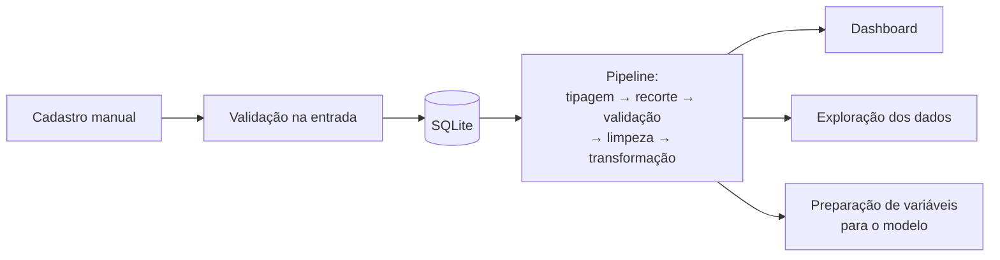
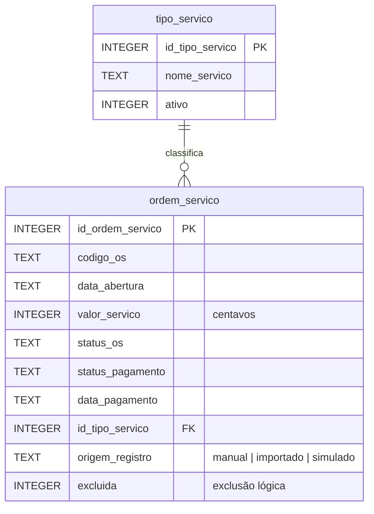

# CG CELL Repair — Dashboard Inteligente

Dashboard para gestão e análise de dados de uma assistência técnica de celulares, desenvolvido em Python
com Streamlit, Pandas, Plotly e SQLite. Projeto acadêmico do curso de Análise e Desenvolvimento de Sistemas.

> **Status:** em desenvolvimento — **Etapa 4 de 8 concluída**: cadastros, dashboard e pipeline de dados
> funcionando. O módulo de Machine Learning ainda não foi implementado. Veja o [roadmap](#roadmap).

---

## Problema e solução

A **CG CELL Repair** (assistência técnica de celulares em Sorocaba-SP) já usa um sistema de ordens de serviço (OS),
mas ele não oferece uma visão gerencial dos dados.

Este projeto é uma **ferramenta complementar** — não substitui o sistema atual — para que o gestor visualize:

- faturamento recebido;
- volume de OS;
- serviços mais frequentes;
- evolução dos indicadores ao longo do tempo.

No longo prazo, o objetivo é adicionar um módulo de **Machine Learning** que identifique padrões históricos e gere
previsões úteis ao planejamento.

### Observações importantes

- **Faturamento não é lucro.** O sistema não registra custo de peças, portanto não calcula margem.
- **Não há histórico real de dados.** O sistema de OS atual não exporta dados. Os dados reais entrarão por cadastro
  manual. Qualquer dado gerado para demonstração será identificado como **SIMULADO** na interface, nos gráficos e
  nesta documentação.

---

## Funcionalidades

| Tela | O que faz |
|---|---|
| **📊 Dashboard** | Faturamento recebido, quantidade de OS, OS concluídas e canceladas; evolução do faturamento e do volume; serviços mais frequentes; distribuição por status. Filtros de período (pré-definidos ou personalizado), de origem (apenas reais / apenas simulados / todos) e de agrupamento (dia, semana, mês). |
| **🧾 Ordens de serviço** | Cadastrar OS; consultar com busca por código e filtros de status e origem; editar, registrar pagamento e excluir (conforme as regras de cada situação). |
| **🛠️ Tipos de serviço** | Cadastrar, consultar, ativar e desativar. |
| **🔎 Exploração dos dados** | Raio-x da base: período, ausentes, inconsistências, distribuição por dia da semana, mês e tipo, tempo até conclusão e pagamento, agrupamento temporal sugerido. |

### Regras de cálculo do dashboard

| Indicador | Regra |
|---|---|
| Faturamento recebido | Soma das OS **pagas**, filtradas pela **data de pagamento**. Não é lucro. |
| Quantidade de OS | OS filtradas pela **data de abertura**, em qualquer situação. |
| OS concluídas | OS abertas no período com status Concluída (canceladas nunca contam). |
| Serviços mais frequentes | OS abertas no período, **sem as canceladas**. |
| Todas | OS excluídas logicamente nunca entram. |

Dados SIMULADOS aparecem com aviso no topo, título de gráfico sinalizado e barras **laranjas com hachura**.
Exibição no padrão brasileiro: `DD/MM/AAAA` e `R$ 1.234,56`.

---

## Acessibilidade

Na barra lateral, em **todas as páginas**, a seção **♿ Acessibilidade** tem três recursos.
As escolhas valem para todas as páginas enquanto o app estiver aberto (ficam em `st.session_state`).

| Recurso | O que faz | Critério WCAG 2.x |
|---|---|---|
| **Alto contraste** | Fundo preto, texto branco e destaques em amarelo. Bordas visíveis em campos, botões, indicadores, avisos, tabelas e gráficos. Contorno amarelo no elemento com foco do teclado. Os gráficos também mudam (fundo, eixos, rótulos e cores), e as barras de dados SIMULADOS **mantêm a hachura**, para que nenhuma informação dependa só da cor. | **1.4.6 Contraste (Aprimorado), nível AAA**: no mínimo 7:1 entre texto e fundo. Também 1.4.1 (uso da cor), 1.4.11 (contraste de componentes) e 2.4.7 (foco visível). |
| **Tamanho da fonte** | Normal, Grande (125%) ou Muito grande (150%). Aumenta a página inteira (títulos, rótulos, indicadores, tabelas) e os textos dos gráficos. As colunas passam para a linha de baixo, os gráficos ocupam a largura toda e os títulos quebram linha, sem rolagem lateral nem texto cortado. | **1.4.4 Redimensionar texto, nível AA** (até 200% sem perda de conteúdo) e **1.4.10 Refluxo**. |
| **Resumo em texto dos gráficos** | Abaixo de cada gráfico, um parágrafo que descreve os dados (total, maior e menor período, distribuição percentual, presença de dados SIMULADOS), gerado a partir dos **mesmos dados** do gráfico. Útil para quem usa leitor de tela, que não consegue ler um gráfico. | **1.1.1 Conteúdo não textual, nível A** (alternativa em texto). |

Contrastes medidos com a fórmula de luminância relativa da WCAG (testes em `tests/unitarios/test_acessibilidade.py`):

| Cor sobre o fundo `#000000` | Razão |
|---|---|
| Texto `#FFFFFF` | 21:1 |
| Destaque `#FFD700` | 15,0:1 |
| Gráficos: `#00FFFF`, `#7CFC00`, `#FF8080` | 16,7:1 · 15,8:1 · 8,7:1 |

**Como ativar:** abra o app, role a barra lateral até **♿ Acessibilidade** e ligue os recursos.
Navegue pelas páginas **pelo menu lateral** — recarregar a página (F5) ou digitar o endereço inicia
uma sessão nova e volta tudo ao padrão.

Detalhes técnicos:

- Com alto contraste ou fonte ampliada, as tabelas são exibidas como **tabela HTML** (`st.table`):
  a tabela interativa do Streamlit é desenhada como imagem (canvas) e não segue CSS nem leitores de tela.
- Toda a lógica fica em `cgcell/apresentacao/acessibilidade.py`, em funções puras e testadas
  (contraste, CSS de cada combinação, ajuste dos gráficos e resumos em texto).
- Limitação conhecida: o Streamlit declara a página como inglês (`<html lang="en">`) e não permite
  mudar isso; leitores de tela podem usar pronúncia em inglês e o Chrome pode oferecer tradução
  automática (desative em "Nunca traduzir este site").

---

## Arquitetura

Arquitetura modular em camadas. A interface nunca acessa o banco diretamente: passa sempre pela camada de serviços.

```
Apresentação (Streamlit) → Serviços (regras de negócio) → Dados (SQLite)
                                       ↓
                           Análise (indicadores) → Machine Learning
```

### Fluxo de dados



Todas as análises passam pelo mesmo pipeline. Regras de transformação, análise exploratória e
prevenção de vazamento de dados: [docs/engenharia_de_dados.md](docs/engenharia_de_dados.md).

```
systenRepair/
├── app.py                 # Ponto de entrada do Streamlit
├── cgcell/                # Pacote principal
│   ├── config.py          # Configurações via variáveis de ambiente
│   ├── apresentacao/      # Páginas e componentes Streamlit
│   ├── servicos/          # Regras de negócio e validações
│   ├── dados/             # Conexão SQLite e migrações
│   ├── analise/           # Pipeline, tratamento, agregações, indicadores, exploração
│   └── ml/                # Preparação de variáveis (treino e avaliação na Etapa 5)
├── scripts/               # Utilitários de linha de comando
├── data/                  # Banco SQLite local (fora do Git)
├── docs/                  # Documentação e diagramas
└── tests/                 # unitarios/, integracao/, ml/
```

A análise completa das decisões está em [docs/analise_inicial.md](docs/analise_inicial.md).

---

## Banco de dados



Destaques:

- Valores em centavos e datas em ISO; a conversão para R$ e DD/MM/AAAA acontece só na tela.
- Regras de consistência validadas na camada de serviços **e** como `CHECK` no próprio banco.
- Migrações versionadas (`cgcell/dados/migracoes/0001_...sql`), aplicadas automaticamente.
- Exclusão somente lógica, permitida após 90 dias da abertura.
- Backup com `python -m scripts.backup_banco`.
- Relatório exploratório no terminal com `python -m scripts.relatorio_exploratorio`.

Diagrama completo, regras de edição e procedimento de recuperação:
[docs/banco_de_dados.md](docs/banco_de_dados.md).

---

## Tecnologias

| Tecnologia | Uso | Justificativa |
|---|---|---|
| Python 3.12 | Linguagem principal | Ecossistema de dados e ML. |
| Streamlit | Interface web | Interface com Python puro, sem HTML/JS. |
| Pandas | Manipulação de dados | Padrão para dados tabulares. |
| Plotly | Gráficos interativos | Integração nativa com Streamlit. |
| SQLite | Banco de dados | Já vem com o Python; um arquivo local, sem servidor. |
| python-dotenv | Configuração | Lê o arquivo `.env` com as variáveis de ambiente. |
| Pytest | Testes automatizados | Padrão de mercado para testes em Python. |
| Ruff | Qualidade de código | Linter e formatador rápido, uma ferramenta só. |

---

## Instalação (Windows / PowerShell)

Pré-requisitos: **Python 3.12** e **Git** instalados.

```powershell
# 1. Baixar o projeto e entrar na pasta
git clone https://github.com/Chiebao/cgcell-dashboard-inteligente.git
cd cgcell-dashboard-inteligente

# 2. Criar o ambiente virtual (isola as bibliotecas deste projeto)
python -m venv .venv

# 3. Ativar o ambiente virtual
.\.venv\Scripts\Activate.ps1

# 4. Instalar as dependências (execução + desenvolvimento)
python -m pip install -r requirements-dev.txt

# 5. (Opcional) Criar o arquivo de configuração local a partir do modelo
Copy-Item .env.example .env
```

Se o passo 3 mostrar um erro de "execução de scripts desabilitada", libere scripts **só para a janela atual**
e tente de novo:

```powershell
Set-ExecutionPolicy -Scope Process -ExecutionPolicy RemoteSigned
```

## Execução

### Jeito mais fácil (dois cliques)

Dê dois cliques no arquivo **`iniciar_dashboard.bat`**, na pasta do projeto. Ele:

1. na primeira vez, cria o ambiente virtual e instala as dependências;
2. inicia o app e abre o navegador em `http://localhost:8501`;
3. se o app já estiver aberto, apenas abre o navegador de novo.

Para fechar o app, feche a janela preta que abriu junto.

### Pelo terminal

Com o ambiente virtual ativado:

```powershell
streamlit run app.py
```

O navegador abre em `http://localhost:8501`. Para encerrar, pressione `Ctrl + C` no terminal.

A página recarrega sozinha quando um arquivo do projeto é salvo (opção `runOnSave` em `.streamlit/config.toml`).

## Modo demonstração

> ⚠️ **Todos os dados do modo demonstração são SIMULADOS.** Foram gerados por um script para
> demonstração técnica e capturas de tela, e **não representam a operação real** da CG CELL Repair.

Dê dois cliques em **`iniciar_demo.bat`**. Ele:

1. usa um banco **separado**, `data/demo.db` — o banco principal (`data/cgcell.db`) não é aberto nem alterado;
2. na primeira vez, gera os dados simulados (cerca de 6 meses de OS em dias úteis);
3. abre o app em `http://localhost:8502` (porta diferente, pode ficar aberto junto com o app normal);
4. mostra o aviso **🧪 MODO DEMONSTRAÇÃO** em todas as telas e abre o dashboard com o filtro "Todos".

Para fechar, feche a janela preta da demonstração.

Também é possível gerar os dados pelo terminal:

```powershell
python -m scripts.gerar_dados_simulados             # gera data/demo.db (se estiver vazio)
python -m scripts.gerar_dados_simulados --recriar   # apaga e gera de novo
```

Como os dados são gerados:

| Item | Regra |
|---|---|
| Reprodutibilidade | Semente fixa (`--semente`, padrão 2026). Mesma semente no mesmo dia = mesmos dados. |
| Período | Últimos 6 meses até hoje (`--meses`), segunda a sexta, de 3 a 8 OS por dia. |
| Tipos | Troca de tela, troca de bateria, conector de carga, software e formatação, limpeza e oxidação. |
| Valores | Faixa fictícia por tipo (ex.: tela de R$ 250 a R$ 900); 2% de garantias com valor zero. |
| Status | OS antigas quase todas concluídas (90% pagas); recentes abertas ou em andamento; cerca de 6% canceladas. |
| Origem | Sempre `simulado`; códigos começam com `SIM-`. |
| Segurança | Passa pela camada de serviços (mesmas validações do app) e **recusa** gravar no banco principal. |

## Testes e qualidade

```powershell
python -m pytest          # roda os testes automatizados
python -m ruff check .    # análise estática
```

Os testes nunca usam o banco da aplicação; usam arquivos temporários e dados fictícios.

| Pasta | O que cobre |
|---|---|
| `tests/unitarios/` | Validações, regras de consistência, indicadores, formatação BR, períodos, gráficos, tratamento, agregação, pipeline, exploração e acessibilidade (contraste, CSS, gráficos, resumos) (sem banco). |
| `tests/integracao/` | Conexão, migrações, restrições do banco, cadastros, edição, pagamento, exclusão, backup, indicadores e pipeline a partir do banco, telas (com o `AppTest` do Streamlit) e scripts. |
| `tests/ml/` | Preparação de variáveis para o modelo, com testes de **vazamento de dados**. |

---

## Limitações conhecidas

- Sem histórico real ainda: os indicadores refletem só o que for cadastrado a partir de agora.
- Sem login (limitação do Streamlit); o app foi feito para rodar só no computador da loja.
- Faturamento não é lucro: custos de peças não são registrados.
- Capturas de tela ainda não incluídas (serão feitas no [modo demonstração](#modo-demonstração), com dados SIMULADOS).

---

## Segurança e privacidade

- O app roda **apenas localmente**. O Streamlit não tem login nativo: se um dia for hospedado online, será preciso
  tratar o acesso público e a persistência do SQLite (hospedagens com disco temporário perdem os dados).
- O banco (`data/*.db`), os backups (`backups/`) e o arquivo `.env` ficam **fora do repositório**.
- Todas as consultas SQL são parametrizadas (sem montar SQL com dados do usuário).
- **LGPD:** o projeto evita dados pessoais por design — não armazena nome, telefone ou documento de clientes,
  apenas dados das ordens de serviço necessários à análise.

---

## Roadmap

- [x] **Etapa 1** — Diagnóstico e estrutura do projeto
- [x] **Etapa 2** — Banco de dados e regras de negócio
- [x] **Etapa 3** — Dashboard
- [x] **Etapa 4** — Engenharia de dados
- [ ] **Etapa 5** — Machine Learning (sobre base SIMULADA até haver histórico real)
- [ ] **Etapa 6** — Testes e CI/CD
- [ ] **Etapa 7** — Validação com a empresa
- [ ] **Etapa 8** — Finalização

---

## Licença

Distribuído sob a licença MIT. Veja [LICENSE](LICENSE).
