# Banco de dados

SQLite, um único arquivo local (`data/cgcell.db` por padrão, configurável em `CGCELL_CAMINHO_BANCO`).
O arquivo fica **fora do Git**.

## Diagrama

```mermaid
erDiagram
    tipo_servico ||--o{ ordem_servico : "classifica"

    tipo_servico {
        INTEGER id_tipo_servico PK
        TEXT nome_servico "obrigatório, único (sem diferenciar maiúsculas)"
        TEXT descricao "opcional"
        INTEGER ativo "0 ou 1"
    }

    ordem_servico {
        INTEGER id_ordem_servico PK
        TEXT codigo_os "obrigatório, único"
        TEXT data_abertura "AAAA-MM-DD, obrigatória"
        TEXT data_conclusao "AAAA-MM-DD, opcional"
        INTEGER valor_servico "centavos, >= 0"
        TEXT status_os "aberta | em_andamento | concluida | cancelada"
        TEXT status_pagamento "pendente | pago"
        TEXT data_pagamento "AAAA-MM-DD, opcional"
        INTEGER id_tipo_servico FK
        TEXT origem_registro "manual | importado | simulado"
        INTEGER excluida "exclusão lógica, 0 ou 1"
        TEXT excluida_em "data e hora, opcional"
        TEXT criado_em "data e hora"
        TEXT atualizado_em "data e hora"
    }

    versao_esquema {
        INTEGER versao PK
        TEXT nome_arquivo
        TEXT aplicada_em
    }
```



## Decisões

| Decisão | Motivo |
|---|---|
| Valores em **centavos** (inteiro) | Evita erros de arredondamento de números decimais (`0.1 + 0.2 != 0.3`). |
| Datas em **texto ISO** (`AAAA-MM-DD`) | O SQLite não tem tipo de data; texto ISO ordena e compara corretamente. |
| Status gravados **sem acento** (`concluida`) | Segue a convenção do projeto; a interface mostra o rótulo com acento. |
| `PRAGMA foreign_keys = ON` em toda conexão | O SQLite vem com chaves estrangeiras desligadas por padrão. |
| `ON DELETE RESTRICT` no tipo de serviço | Um tipo usado em alguma OS não pode ser apagado (deve ser desativado). |
| Regras repetidas como **CHECK** no banco | Defesa em profundidade: nem um `INSERT` manual grava dado inconsistente. |
| `date(x) IS x` nas datas | Com `=`, um texto fora do formato passaria, pois `date()` devolve `NULL`. Encontrado por um teste. |
| Código da OS nunca reutilizado | A unicidade vale também para OS excluídas logicamente. |

## Regras de negócio (camada de serviços)

Ficam em `cgcell/servicos/`. As mensagens de erro são em português e podem ser exibidas direto ao usuário.

**Consistência entre campos**
- `pago` exige `data_pagamento`; `pendente` exige `data_pagamento` vazia.
- `data_conclusao` só com status `concluida`.
- Conclusão e pagamento não podem ser anteriores à abertura.
- OS cancelada não pode ter pagamento.
- Valor zero é permitido (garantia/retorno).
- Datas não podem estar no futuro.

**Edição**

| Situação da OS | O que é permitido |
|---|---|
| Aberta ou em andamento | Editar todos os campos (com validação). |
| Concluída, pagamento pendente | Somente registrar o pagamento. |
| Concluída e paga | Nada (finalizada). |
| Cancelada | Nada. |

Toda gravação atualiza `atualizado_em`.

**Tipo de serviço desativado:** não pode ser usado em novas OS nem escolhido numa edição,
mas as OS que já o usavam continuam válidas.

**Exclusão:** somente lógica (`excluida = 1`), e só para OS com **mais de 90 dias** desde a abertura.
OS excluídas não aparecem em listagens, indicadores ou treinamento do modelo.

## Migrações

- Cada arquivo em `cgcell/dados/migracoes/` é uma versão: `0001_esquema_inicial.sql`, `0002_...sql`.
- A tabela `versao_esquema` registra o que já foi aplicado.
- Ao abrir o banco, a aplicação aplica automaticamente as migrações pendentes, em ordem.
- Cada migração roda numa transação: se falhar no meio, nada dela fica gravado.
- **Nunca edite uma migração já aplicada.** Para mudar o esquema, crie o próximo arquivo numerado.

## Backup e recuperação

**Fazer backup** (na raiz do projeto, com o ambiente virtual ativado):

```powershell
python -m scripts.backup_banco
```

A cópia vai para `backups/cgcell_AAAAMMDD_HHMMSS.db`. O script usa a API de backup do SQLite,
que gera uma cópia consistente mesmo com o app aberto.

**Recuperar um backup:**

1. Feche o app (feche a janela preta do `iniciar_dashboard.bat` ou `Ctrl + C` no terminal).
2. Por segurança, renomeie o banco atual:
   ```powershell
   Rename-Item data\cgcell.db cgcell_antigo.db
   ```
3. Copie o backup escolhido para o lugar do banco:
   ```powershell
   Copy-Item backups\cgcell_20261108_210000.db data\cgcell.db
   ```
4. Abra o app de novo.

Recomendação: guardar cópias da pasta `backups/` também fora do computador (pendrive ou nuvem pessoal).
