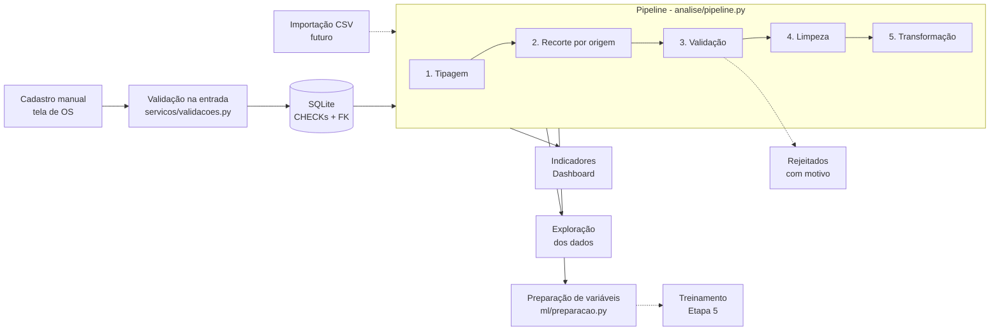

# Engenharia de dados

Como os dados saem do cadastro e chegam aos indicadores, à exploração e ao futuro modelo de previsão.

## Fluxo de dados



Todas as telas que analisam dados usam **o mesmo pipeline**, então um registro é tratado
do mesmo jeito no dashboard, na exploração e no modelo.

## Etapas do pipeline

| # | Etapa | Função | O que faz |
|---|---|---|---|
| 1 | Tipagem | `preparacao.criar_base_analise` | Texto ISO vira data; valor vira inteiro (centavos). **Inválidos viram ausentes** em vez de interromper. Cria `categoria_origem` (Real / SIMULADO). |
| 2 | Recorte | `preparacao.filtrar_por_origem` | Apenas reais, apenas simulados ou todos. Feito antes da validação, para o relatório falar só do recorte escolhido. |
| 3 | Validação | `tratamento.validar_registros` | Aplica as regras de negócio. Registro inválido sai da base e vai para `rejeitados`, com todos os motivos. |
| 4 | Limpeza | `tratamento.remover_duplicados` | Remove códigos de OS repetidos (sem diferenciar maiúsculas e espaços), mantendo o primeiro. |
| 5 | Transformação | `tratamento.adicionar_colunas_derivadas` | Cria `dia_semana`, `mes`, `dias_ate_conclusao`, `dias_ate_pagamento`. |

O pipeline é **reproduzível**: os mesmos registros sempre geram o mesmo resultado (há teste para isso).
Nenhuma função altera o DataFrame recebido; todas devolvem uma cópia.

### Por que validar de novo, se o banco já tem CHECKs?

- O banco protege o que é **gravado** pela aplicação. O pipeline também vai receber dados de
  **importação** (CSV), que podem vir com problemas.
- A validação usa a **mesma função** do cadastro (`verificar_consistencia`). A regra existe num único
  lugar: se mudar, muda em todos.

## Regras de transformação

| Regra | Detalhe |
|---|---|
| Datas | Texto `AAAA-MM-DD`. Qualquer outro formato (ex.: `01/06/2026`) ou data inexistente (`2026-02-30`) vira ausente e o registro é rejeitado se a data for obrigatória. |
| Valores | Inteiros em centavos. Texto não numérico vira ausente e o registro é rejeitado. |
| Ausentes esperados | `data_conclusao` (OS não concluída) e `data_pagamento` (pagamento pendente). Nas demais colunas, ausente é problema. |
| Duplicados | Pela chave `codigo_os`, normalizada (minúsculas, sem espaços nas pontas). |
| Origem | `manual` e `importado` = **Real**; `simulado` = **SIMULADO**. |
| Excluídas | OS com exclusão lógica nunca chegam ao pipeline (a consulta já as ignora). |

## Agregações reutilizáveis (`analise/agregacao.py`)

- `agregar_por_periodo`: conta ou soma por dia, semana ou mês. **Períodos sem registro aparecem com zero**,
  o que é essencial para séries temporais (um mês sem OS é informação, não ausência).
- `agregar_por_tipo_servico`: quantidade e valor dos serviços por tipo.
  Atenção: valor dos serviços ≠ faturamento recebido.

Os indicadores do dashboard usam essas mesmas funções.

## Análise exploratória (`analise/exploracao.py`)

Disponível na tela **🔎 Exploração dos dados** e no terminal:

```powershell
python -m scripts.relatorio_exploratorio --origem todos
```

O relatório só aparece na tela (não é salvo em arquivo), porque pode conter dados reais.

| Pergunta | Onde |
|---|---|
| Quantos registros e de que período? | Resumo, primeira e última OS, dias de histórico |
| Há ausentes ou inconsistências? | Tabela de ausentes (com explicação) e de registros rejeitados |
| Como a demanda se distribui? | Por dia da semana, por mês do ano, por tipo de serviço |
| Quanto tempo leva cada etapa? | Mediana e média de dias até conclusão e até pagamento |
| Qual agrupamento usar no tempo? | Tabela de cobertura e agrupamento sugerido |

**Agrupamento sugerido:** o mais detalhado (dia → semana → mês) com **no máximo 20% de períodos sem OS**
e pelo menos 2 períodos. Muitos períodos vazios deixam a série dominada por zeros e difícil de prever.

A exploração **descreve** os dados. Se eles bastam para treinar um modelo é decidido na Etapa 5,
com critério técnico próprio. Padrões encontrados são descritivos, não causais.

## Preparação de variáveis para o modelo (`ml/preparacao.py`)

Separada do treinamento (que virá na Etapa 5). Transforma a base em uma tabela de "uma linha por período":

| Coluna | Significado |
|---|---|
| `periodo` | Início do período (dia, semana ou mês) |
| `alvo` | O que se quer prever: volume de OS ou faturamento recebido daquele período |
| `defasagem_k` | Valor de k períodos atrás (padrão: 1, 2 e 3) |
| `media_movel_j` | Média dos j períodos **anteriores** (padrão: 3) |
| `indice_tempo` | 0, 1, 2… (tendência) |
| `mes`, `semana_do_ano`, `dia_semana` | Calendário (conhecido com antecedência) |

As séries de volume e de faturamento cobrem **o mesmo intervalo** de tempo, para serem comparáveis.

### Prevenção de vazamento de dados (data leakage)

Vazamento é quando o modelo "vê" informação do futuro durante o treino e parece melhor do que é.
Regras aplicadas:

1. As variáveis da linha do período **t** só usam valores de períodos **anteriores a t**.
2. A média móvel é calculada sobre a série **deslocada em 1 período** (`shift(1)`), então nunca inclui o próprio t.
3. **Defasagem 0 é proibida** (seria o próprio alvo): a função recusa com erro.
4. A série precisa estar em **ordem cronológica e sem períodos repetidos**, senão as defasagens ficariam erradas.
5. As primeiras linhas, sem passado suficiente, são removidas (em vez de preenchidas com valores inventados).

Testes que comprovam (`tests/ml/test_preparacao_variaveis.py`):
- mudar o alvo de um período **não muda** nenhuma variável daquela linha;
- acrescentar períodos futuros **não muda** as linhas do passado;
- defasagem 0 e série fora de ordem são rejeitadas.

A separação treino/teste respeitando a ordem do tempo fica na Etapa 5.
